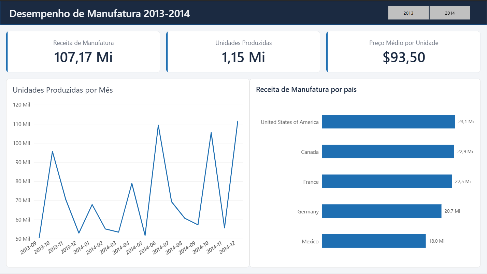

# 📊 Portfólio de Power BI | Alex Derik

Bem-vindo ao meu repositório de portfólio dedicado a soluções de Business Intelligence, modelação de dados e visualização analítica em Power BI. 

Aqui encontras projetos desenvolvidos nas áreas de **Manufatura** e **Vendas**, focados em apoiar a tomada de decisão logística e comercial através de relatórios interativos e dinâmicos (com recurso a *Dark Mode* e paletas visuais otimizadas).

---

## 🚀 Projetos em Destaque

### 1. Desempenho de Manufatura
* **Descrição:** Dashboard focado no acompanhamento de indicadores operacionais de fábrica, eficiência de linhas e controlo de produção.
* **Ficheiro do Relatório:** [Ver ficheiro na pasta Reports](reports/)
* **Pré-visualização:**
  

---

### 2. Análise de Vendas e Desempenho Comercial
* **Descrição:** Relatório analítico de vendas com foco em acompanhamento de metas, margens e comportamento comercial.
* **Ficheiro do Relatório:** [Ver ficheiro na pasta Reports](reports/)
* **Pré-visualização:**
  

---

## 📁 Conjuntos de Dados (Datasets)
Os dados brutos e tratados utilizados como base para a construção destes relatórios estão organizados e disponíveis no repositório:
* **Aceder à pasta de dados:** [Ver pasta Datasets](datasets/)
* *Nota:* Os ficheiros de suporte servem para alimentar a modelação em estrela e as tabelas dimensionais dos relatórios em Power BI.

---

## 🛠️ Tecnologias e Ferramentas
* **Power BI Desktop:** Modelação de dados, DAX avançado, Power Query e construção de dashboards.
* **GitHub:** Controlo de versão e estruturação de portfólio técnico.
* **SQL & Python:** Utilizados no suporte académico e tratamento de fontes de dados na faculdade de Engenharia de Software.

---
📫 **Contacto:** Podes entrar em contacto comigo através do meu perfil do GitHub para trocar ideias sobre projetos de dados e logística!
